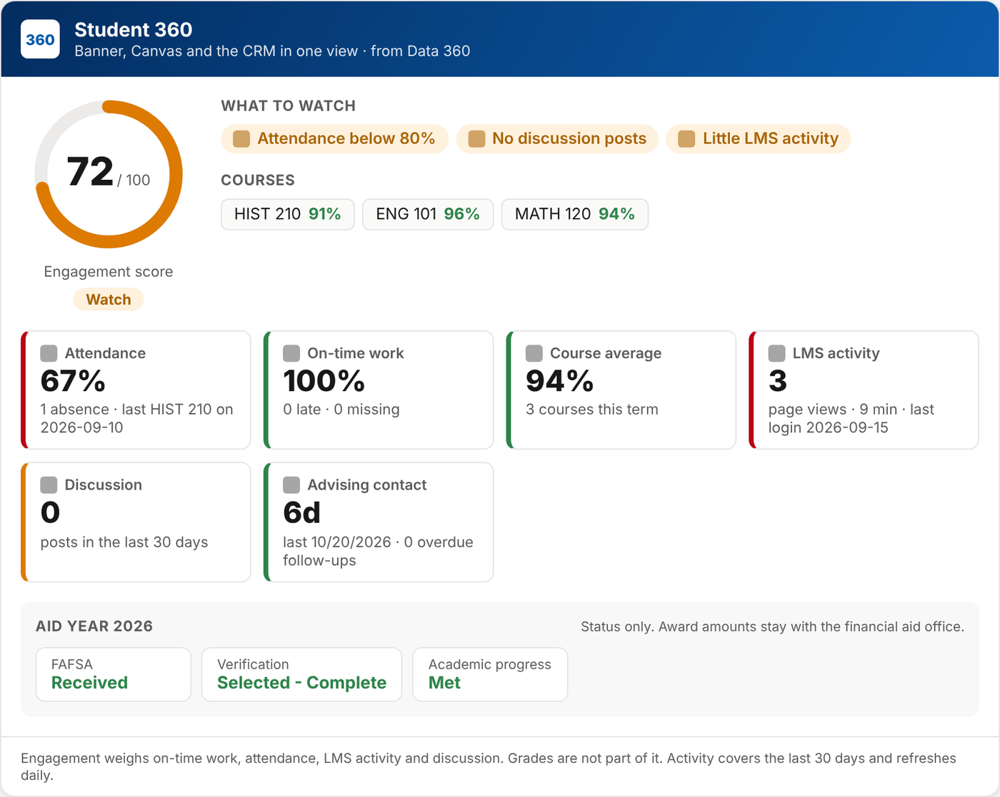

# Post University Student Success Agents

[About me](#about-me) · [About Post University](#about-post-university) · [The goal](#the-goal) · [The challenges](#the-challenges) · [Outcomes](#outcomes-were-driving-and-measuring) · [The recommendation](#the-recommendation) · [Assumptions](#assumptions) · [Advisor Agent](#advisor-agent) · [Student record](#the-student-record) · [Architecture](#architecture) · [Trust boundaries](#trust-boundaries) · [Data 360](#data-360) · [Validation](#focused-technical-validation) · [Setup](#setup) · [Technical specifics](#technical-specifics)

## About me

Hi There! My name is Paul Dewes, and I've worked in the Salesforce ecosystem since 2019.

**Salesforce Support.** I started at Salesforce on the Marketing Cloud Engagement Support team and moved up quickly to Swarm Lead, supporting a group of Support Engineers better work with our customers. There I worked on Marketing Cloud Engagement and Data 360 when it first launched.

**Gerent / TELUS.** I joined Gerent in January of 2023 when a colleague reached out to ask for help in starting a Marketing Cloud practice. The idea of starting something new and learning a whole new way to interact with the Salesforce Ecosystem was a very exciting idea. We built new processes and reusable assets for the Marketing Cloud & Data 360 practice and implemented Marketing Cloud, Data 360 and Agentforce for a variety of different clients across multiple verticals. When Agentforce first launched, I was in the first group to build proofs of concept for customers.

**Today.** I'm a senior member of the Solution Architect team, specializing in Data 360, and I keep taking on new challenges and responsibilities such as Marketing Cloud Next and assisting with pre-sales conversations.

**Outside of work:**

- I'm the Game Master for three different tabletop roleplaying campaigns.
- I ride motorcycles in great places and on race tracks.
- I recently took my mom on her first vacation since I was born, to my favorite place in the US: Glacier National Park.

<table>
  <tr>
    <td width="50%"></td>
    <td width="50%"></td>
  </tr>
  <tr>
    <td align="center"><em>Riding on the Tail of the Dragon in Tennessee/North Carolina</em></td>
    <td align="center"><em>Glacier National Park, with my mom (who I learned is afraid of heights on the Going to the Sun Road where this picture is taken)</em></td>
  </tr>
</table>

 

---

 

## About Post University

Post University has been educating students in Waterbury, Connecticut, since 1890. Today, most Post University students learn online. Many of them are working adults, military-affiliated, career changers, or returning to finish a degree.

Post University knows that school is often the first thing to slip when work, family or service make demands on a student's time. For many students, a missed class becomes a missed assignment, and missed assignments can quickly snowball into course withdrawals, failing grades or leaving altogether.

Post University's promise is an education that works with students' lives, not against them. Leadership is now asking: *how can we step in and help students more proactively, before it's too late?*

> **Demo scenario.** This is a design and validation exercise. It is not affiliated with or endorsed by the university, and all student data is synthetic. No real student data is used.

## The goal

- **More students stay enrolled and graduate.**
- **Staff have reliable tools** to understand and engage their students.
- **Staff give timely, relevant guidance**, reaching out while it can still make a difference.

## The challenges

- **Advisors work across siloed systems.** The early warning signs are spread across Canvas (missed classes, late work, fewer logins), Banner (financial aid paperwork) and the CRM (no recent contact, overdue follow-ups). Seeing the whole picture means opening all three and piecing it together by hand.
- **Each advisor covers more students.** Budget pressure has raised caseloads, so that prep work crowds out the outreach itself.
- **The data is messy and duplicated.** The same student appears several times across systems, which makes finding the right student and the right record harder.

## Outcomes we're driving and measuring

| Outcome | How we'll know |
|---|---|
| Advisors spend their time on students, not on gathering data | **Prep time per student** goes down |
| At-risk students hear from their advisor sooner | **Days from an engagement drop to outreach** go down |
| Outreach turns into conversations | **Share of flagged students who book a meeting** goes up |
| Fewer students leave; more graduate | Term-to-term persistence, attrition and graduation rate, tracked over terms |
| Faster isn't careless | Advisor edits per draft, access refusals, and zero financial aid amounts exposed |

The first three move within weeks, so they decide the pilot. Persistence and graduation take terms, so they decide the rollout.

## The recommendation

Give every advisor an **Advisor Agent** in Agentforce, grounded in one trusted view of each student from **Data 360**.

The agent brings Banner, Canvas and the CRM together for one student, tells the advisor the two or three things that need attention, and turns that into action: a supportive outreach email with a single-use booking link, a follow-up task and a note. It works only on the advisor's own students, and nothing goes to a student without the advisor reviewing it. Banner and Canvas stay where they are, read from Snowflake with zero copy.

| Today | With the Advisor Agent |
|---|---|
| Opens three systems to prepare for one student | Asks "What should I know about this student?" and gets one summary |
| Notices disengagement when a grade drops or the student goes quiet | Sees attendance, LMS activity, engagement and the last contact together, with what to act on |
| Writes each check-in email from scratch | Reviews a specific, supportive draft with a booking link for that student |
| Follow-ups live in memory or a notebook | A task and a note are logged on the student record in the same conversation |

### Why this fits

**It answers each challenge.**

| Challenge | How the recommendation answers it |
|---|---|
| Advisors work across siloed systems | Data 360 joins Banner, Canvas and the CRM into one view of each student. The advisor asks one question instead of opening three systems, and each system of record stays where it is. |
| Each advisor covers more students | The agent does the prep work: the summary, what to act on, a drafted email, a booking link, a task and a note, in one conversation. Advisor time goes to the outreach and 1:1 human connection with the student. |
| The data is messy and duplicated | Identity resolution matches the same student across systems and merges duplicates into one record, so the agent always works from the right student. The engagement score is calculated once, the same way for everyone. |

**It moves each goal.**

- **More students stay enrolled and graduate.** The agent surfaces early signs (missed classes, falling LMS activity, a dropping engagement score, no recent contact) and shortens the time from a student slipping to their advisor reaching out with a way to meet. That gap is what the pilot measures.
- **Staff have reliable tools.** Answers come from one trusted student record, never from guesses. The agent only works on the advisor's own students, shows financial aid as status only, and was tested case by case before going live.
- **Staff give timely, relevant guidance.** The agent names the two or three things that matter for this student and drafts outreach that speaks to them, and the advisor reviews every message before it goes out.

**How it gets there:** take baselines → pilot with one advising team → roll out to all advisors and track persistence → phase 2, an Admissions Agent or additional data for the Advisor Agent. Running cost grows with how much advisors use the agent, not with the number of students, and keeping a small number of extra students enrolled covers the first year. [Costs and savings](docs/cost-model.md)

## Assumptions

- **Outreach timing matters for retention.** If faster outreach doesn't raise bookings, the agent saves advisors time but doesn't move persistence. The pilot tests this directly.
- **The engagement score flags the right students.** Before rollout, compare who it flags with who actually withdrew last term.
- **Bookings can be measured.** The pilot needs Calendly booking events written back to the CRM.
- **The CRM knows each student's advisor.** A nightly load from Banner keeps students and their assigned advisor (the Contact owner) current in Education Cloud.

## Advisor Agent

The Advisor Agent is an Agentforce **employee agent**. Advisors use it in the Agentforce panel on a student's record or on Home, and in Slack. It never talks to students directly, and nothing it writes reaches a student without the advisor.

| Action | What it does |
|---|---|
| Find Students | Searches the advisor's own students by name, Student ID or email. Other advisors' students never come back. |
| Get Student 360 Data | One summary: attendance, coursework, LMS activity, discussion posts, engagement score, financial aid status (no amounts), last advising contact and overdue follow-ups. |
| Draft Student Outreach Email | A warm, specific check-in email based on that summary, with a single-use booking link. |
| Create Calendly Booking Link | Just the booking link, pre-filled with the student's name and email. |
| Create Student Task | A follow-up task for the advisor, on the student's record. |
| Log Student Note | An advising note on the student's record. |
| Update Student Record | Changes a short list of allowed fields, only after the advisor confirms. |

On a student's record it uses that student without asking. Anywhere else, it asks which student you mean or searches for them.

**Three builds of the same agent.** `Academic_Advisor_Standard` uses standard Agentforce actions to find and update students, with Salesforce sharing doing the owner check, a Prompt Builder template for the email, and custom code only where nothing standard exists (Data 360, Calendly, notes). `Academic_Advisor_Hybrid` moves the access check, tasks and record updates into Flow. `Academic_Advisor_Student_Success` runs every action in Apex. All three are live and are checked against the same test suite. [Why each action is standard, Flow or Apex](docs/flow-vs-apex.md)

### A typical conversation

Illustrative, based on a real 360 summary for a synthetic student:

> **Advisor (on Priya's record):** What should I know about this student?
>
> **Agent:** She's doing strong work when she submits (94% on graded work), but she missed a recent HIST 210 class, hasn't posted in discussions, and her LMS activity has dropped since mid-September. Her engagement score is 71.6. Financial aid is complete and SAP is met.
>
> **Advisor:** Draft her a check-in email.
>
> **Agent:** *(draft with a single-use booking link)* Want me to log a note and set a follow-up task?

## The student record

The same Data 360 view is on the student's record page, so an advisor gets the picture before they ask the agent anything.

Illustrative preview with synthetic values. In the org the card reads the student's live Data 360 profile.

- **The engagement score, front and centre.** The Student Engagement Score (the Data 360 calculated insight) shows as a gauge with a plain band: *On track*, *Watch* or *At risk*.
- **What to watch.** The same signals the agent calls out, as short flags: missed classes, late or missing work, no discussion posts, little LMS activity, aid paperwork pending, academic progress at risk, no recent contact, overdue follow-ups.
- **Six numbers at a glance:** attendance, on-time work, course average, LMS activity, discussion posts and days since the last advising contact, each coloured by how it's trending.
- **Financial aid as status only:** FAFSA, verification and academic progress, with no award amounts.
- **The detail behind it.** The Data 360 related lists for enrollments, attendance, submissions, page views, discussion posts and aid status now show the columns an advisor needs, newest first.

**Why it matters to an advisor:**

- **Prep in seconds, not three systems.** Opening a student's record answers "how are they doing?" before the call or meeting.
- **Triage without asking.** The colour and the flags show who needs outreach today, even on a full caseload.
- **One source of truth.** The card, the related lists and the agent all read the same Data 360 profile, so the advisor never sees two different answers.
- **The agent is one click away.** From the same page the advisor can ask the agent to draft the email, set the follow-up and log the note.

[How the record page is built](docs/technical-details.md#student-record-page)

## Architecture

- **Banner and Canvas stay where they are.** Their data already lands in Snowflake, and Data 360 reads it there with zero copy. Nothing is written back.
- **Data 360 builds the student view.** It matches each student across systems, calculates the engagement score, and packages what the agent needs into one Student 360 data graph.
- **Education Cloud holds the advising work.** Students, their assigned advisor, tasks and notes live in the CRM, kept current by a nightly load from Banner.
- **Agentforce does the reasoning and actions**, grounded in the data graph, with every model call going through the Einstein Trust Layer.
- **Calendly and Slack connect where advisors already work:** booking links for students, and the agent inside Slack.

### Trust boundaries

- **Own students only.** Every action checks that the advisor owns the student before touching Data 360, the model or Calendly. Search never returns anyone else's students. In the org, Contact sharing is Private, so advisors can't open other advisors' students either.
- **Advisor in the loop.** Emails are drafts. Record updates need the advisor's confirmation and only touch allowed fields.
- **Financial aid is status only.** Award amounts aren't in the data the agent can see.
- **No invented links or facts.** Booking links are created by code, not the model. If something isn't in the data, the agent says so.
- **Einstein Trust Layer** on every model call. Student names stay out of the prompt.

[All six boundaries in detail](docs/technical-details.md#trust-boundaries)

### Data 360

- **Zero copy:** Banner and Canvas are read straight from Snowflake.
- **Identity resolution:** the same student across Banner, Canvas and the CRM becomes one unified student.
- **Engagement score:** 0 to 100, from on-time work, attendance, LMS activity and discussion posts. Grades are left out on purpose: it measures behaviour, not performance.
- **Student 360 data graph:** one package of what the agent needs per student, refreshed daily.

[Streams, ruleset, score and graph in detail](docs/technical-details.md#data-360)

## Focused technical validation

**The question:** when the agent grounds on Data 360, does it see only the advisor's own students?

**The answer:** no. Data 360 returns any student to a direct query, so the advising relationship is enforced in the agent's actions instead.

- **13 action-level checks:** own student allowed, another advisor's student refused before anything happens, protected fields rejected, aid amounts never reach the agent.
- **Agent test suites** (90+ cases per agent) cover grounding, other advisors' students, aid amounts, prompt injection and off-topic requests. Each run found something, and each fix is written up.
- **Apex and Flow tests** cover every refusal path.

[Method, results and raw outputs](validation/README.md)

## Setup

1. **Data:** load Banner and Canvas into Snowflake, create a read-only integration user with key-pair auth, and load students into the CRM.
2. **Data 360:** connect Snowflake, create the streams, then the identity ruleset, the engagement score and the data graph.
3. **Salesforce:** `sf project deploy start --source-dir force-app --target-org <alias>`
4. **Calendly:** create the named credential and paste the token in Setup, never in code.
5. **Agent:** paste the Agent Script into a new employee agent, publish, activate, and assign the permission sets.
6. **Student record page:** activate *Student Record Page* for Contact (the deploy includes it as the org default).

[Full setup steps](docs/technical-details.md#setup)

## Technical specifics

The full depth lives in [**Technical details**](docs/technical-details.md). Start there, or go straight to a topic:

| Topic | Where |
|---|---|
| Actions, the code behind each, and the Agent Script | [Actions and implementation](docs/technical-details.md#actions-and-implementation) · [Why each action is Flow or Apex](docs/flow-vs-apex.md) |
| The Student 360 card and record page | [Student record page](docs/technical-details.md#student-record-page) |
| What stays where, nightly load, trust boundaries | [Architecture details](docs/technical-details.md#architecture-details) |
| Data streams, identity resolution, engagement score, data graph | [Data 360](docs/technical-details.md#data-360) |
| How it was tested, and what the tests changed | [Validation in detail](docs/technical-details.md#focused-technical-validation) · [Full write-up and raw results](validation/README.md) |
| Building it in your own org | [Full setup](docs/technical-details.md#setup) · [Repository structure](docs/technical-details.md#repository-structure) |
| Running it | [Operations](docs/operations.md) · [Demo script](docs/demo-script.md) |
| Handing it to a build team | [Execution handoff](docs/technical-details.md#execution-handoff) · [Build team one-pager](docs/execution-handoff.md) · [What changes if a constraint changes](docs/changed-constraints.md) |
| Cost, limits and AI use | [Costs and savings](docs/cost-model.md) · [Limitations](docs/technical-details.md#limitations) · [How AI was used](docs/ai-usage.md) |
