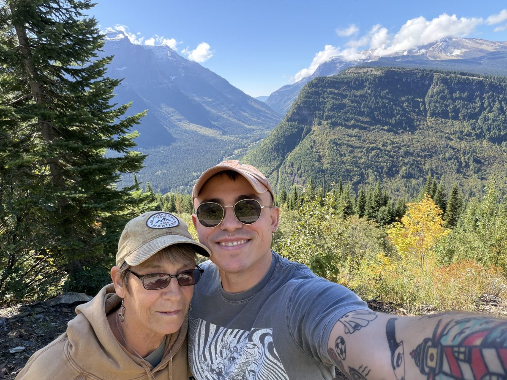
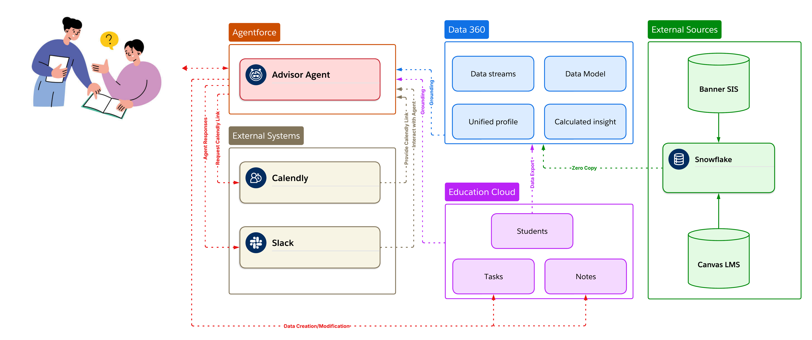
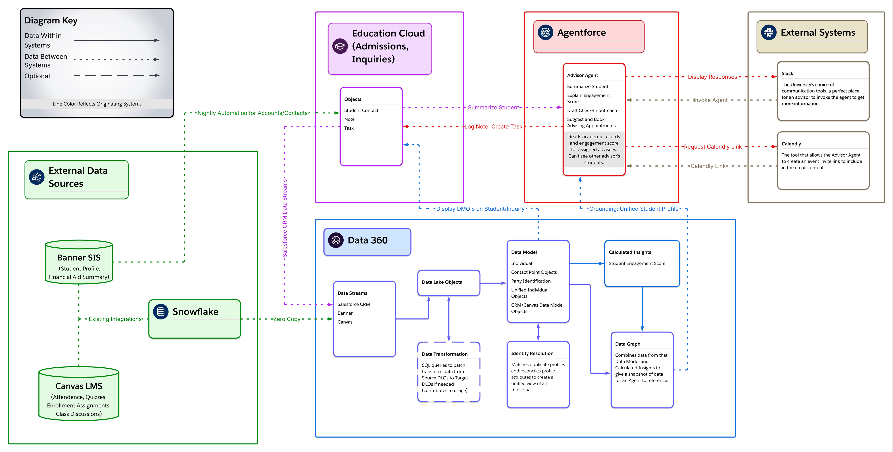

# Post University Student Success Agents

## About me

Hi There! My name is Paul Dewes, and I've worked in the Salesforce ecosystem since 2019.

**Salesforce Support.** I started at Salesforce on the Marketing Cloud Engagement Support team and moved up quickly to Swarm Lead, supporting a group of Support Engineers better work with our customers. There I worked on Marketing Cloud Engagement and Data 360 when it first launched.

**Gerent / TELUS.** A former colleague asked me to help start a Marketing Cloud practice at Gerent where I joined in January of 2023. We built new processes and reusable assets for the Marketing Cloud & Data 360 practice and implemented Marketing Cloud, Data 360 and Agentforce for a variety of different clients across multiple verticals. When Agentforce first launched, I was in the first group to build proofs of concept for customers.

**Today.** I'm a senior member of the Solution Architect team, specializing in Data 360, and I keep taking on new challenges and responsibilities such as Marketing Cloud Next and assisting with pre-sales conversations.

**Outside of work:**

- I'm the Game Master for three different tabletop roleplaying campaigns.
- I ride motorcycles in great places and on race tracks.
- I recently took my mom on her first vacation since I was born, to my favorite place in the US: Glacier National Park.

<table>
  <tr>
    <td width="50%"></td>
    <td width="50%"></td>
  </tr>
  <tr>
    <td align="center"><em>On a favorite stretch of road</em></td>
    <td align="center"><em>Glacier National Park, with my mom</em></td>
  </tr>
</table>

---

**Post University wants more of its students to stay enrolled and graduate.** Advisors are the main way the university can step in when a student starts to drift, but they find out late. The early signs are spread across three systems:

- missed classes, late submissions and a drop in logins, in Canvas;
- a FAFSA that hasn't been verified for a new year or semester, in Banner;
- no advising contact in weeks, an overdue follow-up, or a change in status such as going on leave, in the CRM.

To see the whole picture, an advisor has to open all three and piece it together by hand, for each student. With a large caseload, that prep work crowds out outreach. By the time an advisor reaches out, the student has often been struggling for quite some time.

This project designs and validates an **Advisor Agent** in Agentforce. It shortens the time from "a student starts struggling" to "their advisor reaches out with a way to book a meeting to help," and it removes the prep work that stands in the way. The agent pulls one trusted view of a student from Data 360 (built from Banner, Canvas and the CRM), tells the advisor what needs attention, and turns that into action: an outreach email with a booking link, a follow-up task and a note. It only ever works on the advisor's own students.

> **Demo scenario.** This is a design and validation exercise. It is not affiliated with or endorsed by the university, and all student data is synthetic. No real student data is used.



## Outcomes and how we'll know

| Level | Outcome | Measure | Source |
|---|---|---|---|
| **University goal** (lagging, terms to years) | Fewer students leave; more graduate | Term-to-term persistence · attrition rate · graduation rate | Banner, institutional research |
| **Advising goal** | Advisors spend their time on students, not on gathering data | **Advisor prep time per student** | Time study before the pilot, then agent session timing |
| | At-risk students hear from their advisor sooner | **Days from an engagement drop to outreach** | The date the Data 360 engagement score falls below threshold, to the date of the outreach task, note or email |
| | Outreach turns into conversations | **Share of flagged students who book a meeting** | Single-use Calendly links created, matched to bookings |
| **Guardrail** | Faster isn't careless | Advisor edits per draft · access refusals · zero financial aid amounts exposed | Agent logs, Testing Center suite |

The three advising measures move within weeks, so they're what the pilot is judged on. Persistence and graduation take terms to show up, so they're tracked for the rollout decision, not for the pilot.

### What changes for an advisor

| Today | With the Advisor Agent |
|---|---|
| Opens three systems to prepare for one student | Asks "What should I know about this student?" and gets one summary from Data 360 |
| Notices disengagement when a grade drops or the student goes quiet | Sees attendance, LMS activity, engagement and the last advising contact together, with the two or three things to act on |
| Writes each check-in email from scratch, then sends a generic booking page | Reviews a specific, supportive draft with a single-use Calendly link for that student |
| Follow-ups live in memory or a notebook | A follow-up task and a note are logged on the student record in the same conversation |

## The decision

| | |
|---|---|
| **Problem** | Advisors spot disengaged students late, because the signals sit in three systems. That costs prep time, delays outreach, and loses students who could have been kept. |
| **Owner** | Provost's office (advising). The VP of Enrollment owns the phase 2 Admissions Agent. |
| **Recommendation** | Build an Agentforce agent for advisors, grounded in a Data 360 data graph over Banner and Canvas. The Banner and Canvas streams stay in Snowflake (zero copy); the graph keeps a daily copy of only the fields the agent needs. Keep each system of record where it is. Check in the agent's actions that the student belongs to the advisor. |
| **Success for the pilot** | Compared with baselines taken before launch: lower prep time per student, fewer days from an engagement drop to outreach, and a higher share of flagged students booking a meeting, with no guardrail breaches. |
| **Investment** | Running cost grows with how much advisors use the agent, not with the number of students. Keeping a small number of extra students enrolled covers the first year, before counting advisor time saved. [Costs and savings](docs/cost-model.md) |
| **Path to value** | Take baselines → pilot with one advising team → run the agent test suite and move Calendly to OAuth → roll out to all advisors and track persistence → phase 2 Admissions Agent |

### Assumptions that would change this

- **Outreach timing matters for retention.** If faster outreach doesn't raise bookings, the agent saves advisors time but doesn't move persistence. The pilot tests this directly.
- **The engagement score flags the right students.** Before rollout, compare who it flags with who actually withdrew last term.
- **Bookings can be measured.** The demo creates booking links but doesn't record whether a meeting was booked. The pilot needs Calendly's booking events written back to the CRM, which is planned for phase 2.

## Advisor Agent

`Academic_Advisor_Student_Success` is an Agentforce **employee agent**, live in the Agentforce panel on student records and Home, and in Slack. It never talks to students, and nothing it writes is sent without the advisor.

| Action | What it does | Implementation |
|---|---|---|
| Find Students | Searches the advisor's own students by name, Student ID, email or record Id | [`FindStudentsAction`](force-app/main/default/classes/FindStudentsAction.cls): owner filter in the SOQL, so other advisors' students never reach the agent |
| Get Student 360 Data | Last advising contact and overdue follow-ups (live from the CRM), plus attendance, submissions, enrollments and scores, LMS activity, discussion posts, financial aid status (no amounts) and engagement score | [`Student360DataAction`](force-app/main/default/classes/Student360DataAction.cls) → data graph, with [`StudentAdvisingActivity`](force-app/main/default/classes/StudentAdvisingActivity.cls) for CRM activity |
| Draft Student Outreach Email | A warm, specific check-in email based on the 360 summary, with a single-use Calendly link | [`DraftStudentEmailAction`](force-app/main/default/classes/DraftStudentEmailAction.cls) → Models API + Calendly |
| Create Calendly Booking Link | Just the link, pre-filled with the student's name and email | [`CreateCalendlyBookingLinkAction`](force-app/main/default/classes/CreateCalendlyBookingLinkAction.cls) |
| Create Student Task | Follow-up task for the advisor, linked to the student | [`CreateStudentTaskAction`](force-app/main/default/classes/CreateStudentTaskAction.cls) |
| Log Student Note | Advising note on the student record | [`LogStudentNoteAction`](force-app/main/default/classes/LogStudentNoteAction.cls) |
| Update Student Record | Allow-listed fields only, after the advisor confirms | [`UpdateStudentRecordAction`](force-app/main/default/classes/UpdateStudentRecordAction.cls) |

The agent is written in Agent Script: [`agent/Academic_Advisor_Student_Success.agent`](agent/Academic_Advisor_Student_Success.agent).

**A second build, Flow plus Apex.** `Academic_Advisor_Hybrid` is the same agent with the access check and simple record work moved into Flow: [Create Student Task](force-app/main/default/flows/Advisor_Create_Student_Task.flow-meta.xml) and [Update Student Record](force-app/main/default/flows/Advisor_Update_Student_Record.flow-meta.xml) (same 14 fields). Both call one shared check flow first, [Check Student Access](force-app/main/default/flows/Advisor_Check_Student_Access.flow-meta.xml), which only reads the student if the running advisor owns them. The search, Data 360, Calendly, email and notes stay in Apex. Both agents are active. [Why each action is where it is](docs/flow-vs-apex.md)

- **On a student record**, it uses that student without asking.
- **Anywhere else** (Home, another object, Slack), it asks which student you mean or searches for them. It never treats a non-student record Id as a student.

### A typical conversation

Illustrative, based on a real 360 summary for a synthetic student:

> **Advisor (on Priya's record):** What should I know about this student?
>
> **Agent:** She's doing strong work when she submits (94% on graded work), but she missed a recent HIST 210 class, hasn't posted in discussions, and her LMS activity has dropped since mid-September. Her engagement score is 71.6. Financial aid is complete and SAP is met.
>
> **Advisor:** Draft her a check-in email.
>
> **Agent:** *(draft with a single-use booking link)* Want me to log a note and set a follow-up task?

## Architecture



### What stays where

| System | Owns | How Salesforce uses it |
|---|---|---|
| **Banner SIS** | Student profile, holds, financial aid | Read through Snowflake, zero copy. A nightly automation also loads students into the CRM (below) |
| **Canvas LMS** | Enrollments, submissions, attendance, page views, discussions | Read through Snowflake, zero copy |
| **Snowflake** | The university's existing landing zone for Banner and Canvas | Direct Access data streams into Data 360 |
| **Data 360** | Identity resolution, the unified student, the engagement score, the Student 360 data graph | Grounding for the agent |
| **Education Cloud (CRM)** | Students (Contacts), advisor assignment, tasks, notes | System of record for advising work |
| **Agentforce** | Reasoning, action selection, advisor conversation | Employee agent in Lightning and Slack |
| **Calendly** | Advisor calendars, availability, bookings | Single-use links through a Named Credential |
| **Slack** | Where advisors already work | Agentforce in Slack, with users mapped to Salesforce users |

Nothing is written back to Banner, Canvas or Snowflake.

**Nightly automation (Banner → CRM).** The diagram's arrow from Banner to the CRM is the student load: each night, new and changed students are upserted into Education Cloud as Contacts, keyed on Student ID, with name, email, stage and level, and the assigned advisor as the Contact owner. It's what makes the CRM search and the owner check work, so it's a production dependency owned by University IT. In the demo org the Contacts were loaded once from the synthetic data instead.

**Einstein Trust Layer.** It isn't drawn on the diagrams, but it sits between the agent and the model on every call: the agent's own reasoning and the email draft. See trust boundary 2.

### Trust boundaries

1. **Advising relationship.** Every action that takes a student calls [`StudentAccess.ownedStudent()`](force-app/main/default/classes/StudentAccess.cls) first: a `WITH USER_MODE` query plus a check that the advisor owns the Contact. This runs **before** any Data 360, LLM or Calendly call. The search ([`FindStudentsAction`](force-app/main/default/classes/FindStudentsAction.cls)) has the owner filter in its SOQL, so other advisors' students never reach the agent at all. Both are needed because Data 360 doesn't know who a student's advisor is (see [validation](validation/README.md)).
2. **Einstein Trust Layer.** All model calls go through it. Student names are kept out of the prompt entirely; the model writes `{FIRST_NAME}` and Apex fills it in, because masking was mangling names.
3. **No unreviewed outreach.** Emails are drafts only. Record updates need the advisor's confirmation and only touch allow-listed fields (owner and student ID can never change).
4. **No invented links.** The Calendly link is created first and inserted by Apex, so the model never writes a URL. `calendly.com` is the only added Trusted URL.
5. **Financial aid is status only.** Advisors see FAFSA, verification and satisfactory-academic-progress status. Award amounts, need, cost of attendance, Pell and the aid index aren't in the data graph at all, and an Apex allow-list strips anything else before the agent sees the data. If asked, the agent refers the student to the financial aid office.
6. **Least data in outreach.** The email prompt bars grades, scores, aid details and system names, so the student sees patterns, not numbers.

## Data 360

- **Data streams:** Banner and Canvas tables are **Direct Access** (federated from Snowflake). CRM Contacts are ingested. [Details](data360/data-streams.md)
- **Identity resolution:** an exact match on Party Identification (`Student ID`, `Person Identifier`) ranks first, with fuzzy name plus email or phone as fallbacks. The last run unified **2,777 source profiles into 1,000 students**. [Ruleset](data360/identity-resolution/Student_Default.json)
- **Student Engagement Score:** a calculated insight, 0 to 100. It weights on-time submissions 35%, attendance 30%, LMS page views 20% (capped at 20) and discussion posts 15% (capped at 5). Grades are deliberately excluded: engagement is behaviour, not performance. [SQL](data360/calculated-insights/Student_Engagement_Score.sql)
- **Student 360 data graph:** rooted on the unified individual. It reaches the Canvas and Banner rows through the identity links, and adds the engagement score. Engagement objects are limited to the last 30 days (10 records), and the graph refreshes daily. [Definition](data360/data-graphs/Student_360_Graph.md)

**Identity keys:** `Contact.Student_ID__c` = `UnifiedIndividual.Student_ID__c` = Canvas `user_id` (e.g. `U00002`). Banner joins on `banner_id` (the S-number) through its own Individual.

## Focused technical validation

**The uncertainty:** when the agent grounds on Data 360, does it see only that advisor's students, or every student the running user can see?

**What was found:** Data 360 returns any student to a direct query, so the advising relationship has to be enforced in the actions. All 13 action-level cases behaved as expected:

- own student: allowed;
- another advisor's student: refused before any side effect;
- protected fields: rejected;
- financial aid amounts: never reach the agent (now also dropped from the graph).

A control query showed Data 360 alone would have exposed the other advisor's student.

**Then the agent itself was tested** in Testing Center, four runs on four agent versions:

| Run | Agent | Cases | Responses passed | What it changed |
|---|---|---|---|---|
| 1 | v5 | 75 | 63 | Found that the standard Query Records search returned other advisors' students to the agent. Replaced with an owner-filtered Apex search |
| 2 | v7 | 80 | 75 | Every other-advisor case passed. Found a GPA estimate and an ignored harsh-email request |
| 3 | v8 | 20 | 19 | Retests passed. Found the name-plus-Student-ID search bug |
| 4 | v8 | 20 | 19 | Retests passed. Found extra words breaking the search |

Each fix is in the [validation write-up](validation/README.md), along with the raw exports.

**And the code has tests.** [`AdvisorAgentTests`](force-app/main/default/classes/AdvisorAgentTests.cls): 21 Apex tests, all passing, about 86% coverage (494 of 572 lines). They cover the refusal path of every action, the owner-filtered search, the aid allow-list, the advising-activity summary and the Calendly calls (mocked). The Models API call and the live Data 360 read can't run inside Apex tests. [Results](validation/results/2026-10-26-apex-tests.json)

The hybrid agent's flows have their own tests: [`AdvisorFlowTests`](force-app/main/default/classes/AdvisorFlowTests.cls) runs each flow through `Flow.Interview`. 9 tests, all passing, including the check flow on its own; another advisor's student is refused with nothing written. [Results](validation/results/2026-10-26-flow-tests.json)

→ [Method, results and raw outputs](validation/README.md)

## Setup

### Prerequisites

- A Salesforce org with Education Cloud, Data 360 and Agentforce (one Agentforce license per advisor)
- A Snowflake account, with a role that can create a database, schema and integration user
- A Calendly Teams or Enterprise organization that all advisors belong to
- Salesforce CLI (`sf`), plus Data Loader for CRM data
- Optional: a Slack workspace where you are an admin

### 1. Data

1. Load the Banner and Canvas tables into Snowflake (Snowsight → **Add Data**).
2. Create an integration user and role with read access, using key-pair authentication:
   ```sh
   openssl genrsa 2048 | openssl pkcs8 -topk8 -inform PEM -out rsa_key.p8 -nocrypt
   openssl rsa -in rsa_key.p8 -pubout -out rsa_key.pub
   ```
   ```sql
   ALTER USER DATA360_USER SET RSA_PUBLIC_KEY='<public key without header and footer>';
   ```
3. Load CRM Contacts with `Student_ID__c` set to the Canvas `user_id`.

### 2. Data 360

1. Create the Snowflake connection (Data Cloud Setup → External Integrations → Snowflake).
2. Create the streams listed in [data-streams.md](data360/data-streams.md): Direct Access for Snowflake, ingest for the CRM.
3. Map Individual, Party Identification and Contact Points, then create the [identity ruleset](data360/identity-resolution/Student_Default.json).
4. Create the [engagement score](data360/calculated-insights/Student_Engagement_Score.sql) insight.
5. Build `Student_360_Graph` from [its definition](data360/data-graphs/Student_360_Graph.json) with the Data 360 `d360_data_graph_create` tool, or in the UI [as documented](data360/data-graphs/Student_360_Graph.md).

### 3. Salesforce metadata

```sh
sf project deploy start --source-dir force-app --target-org <alias>
```

This deploys:

- the Apex actions;
- the `User.Calendly_Event_Type_URI__c` field;
- the Calendly Trusted URL;
- the two permission sets.

### 4. Calendly

Create the external credential and named credential, then set each advisor's event type URI. Follow [integrations/calendly.md](integrations/calendly.md). Paste the token in Setup, not in code.

### 5. Agent

1. Create a new employee agent in Agentforce Builder and replace its script with [`agent/Academic_Advisor_Student_Success.agent`](agent/Academic_Advisor_Student_Success.agent).
   For the Flow + Apex build, deploy the three flows in `force-app/main/default/flows/` first, check flow first (they ship as Active), then use [`agent/Academic_Advisor_Hybrid.agent`](agent/Academic_Advisor_Hybrid.agent).
2. Publish and activate it.
3. Grant it in **Academic Advisor Agent Access**, then assign each advisor:
   - Academic Advisor Agent Access;
   - Calendly Access;
   - Access Agentforce Default Agent.
4. Optional: add the Slack connection in Agentforce Studio, map users in Slack (Admin → Salesforce → Users), and install the agent (Admin → Manage Agentforce).
5. Optional: turn on Enhanced Notes (Setup → Notes Settings). The note action switches to it automatically.

## Repository structure

```
.
├── README.md
├── sfdx-project.json
├── agent/
│   ├── Academic_Advisor_Student_Success.agent   Agent Script, all-Apex build (live version 8)
│   └── Academic_Advisor_Hybrid.agent            Agent Script, Flow + Apex build (live version 2)
├── force-app/main/default/
│   ├── classes/                                 Apex actions, owner-filtered search, Calendly client, access check, tests
│   ├── flows/                                   Access-check, task and record-update flows for the hybrid agent
│   ├── objects/User/fields/                     Calendly_Event_Type_URI__c
│   ├── cspTrustedSites/                         Calendly trusted URL
│   └── permissionsets/                          Agent access, Calendly access
├── data360/
│   ├── data-streams.md
│   ├── identity-resolution/Student_Default.json
│   ├── calculated-insights/Student_Engagement_Score.sql
│   └── data-graphs/Student_360_Graph.json, .md  Graph definition and notes
├── integrations/
│   └── calendly.md
├── tools/build_flows.py                         Generates the hybrid agent's flows
├── tests/                                       Testing Center suites (CSV upload, sf agent test YAML) and their generators
├── validation/
│   ├── README.md                                Uncertainty, method, results for actions and four agent runs
│   ├── persona-question-matrix.csv
│   └── results/                                 Action guardrail outputs, Testing Center exports (runs 1-4), Apex test results
└── docs/
    ├── execution-handoff.md                     One-pager for the build team
    ├── ai-usage.md                              What AI produced and how it was checked
    ├── cost-model.md                            What drives cost, where the savings come from
    ├── operations.md                            Observability, release gates, runbook
    ├── demo-script.md                           Exact demo prompts and backup recording
    ├── changed-constraints.md                   What changes if a system or requirement changes
    ├── flow-vs-apex.md                          Which actions are Flow, which are Apex, and why
    └── images/
```

## Execution handoff

The build team's one-pager is [docs/execution-handoff.md](docs/execution-handoff.md). It covers scope, interfaces, assumptions, risks, unknowns, owners and exit conditions. The short version:

- **Ready:** the Advisor Agent end to end, the Data 360 model, the Calendly link flow, and action-level access control.
- **Before build:**
  - the Apex tests (written, 21 passing) wired into CI;
  - the Testing Center suite re-run on every agent change;
  - a second advisor tested with their own license;
  - Calendly moved to OAuth.
- **Phase 2:** Admissions Agent, Calendly booking write-back, and the student-facing channel (if ever).

## Limitations

- The data is synthetic, so the engagement score makes no predictive claims. The caps (20 views, 5 posts) are tuned to the sample and need rescaling for a real term.
- Apex coverage is about 86%, above the 75% deploy minimum, but the Models API call and the live Data 360 read are only tested end to end, not in Apex. The original agent's flow (`Academic_Advisor_Agent`) is still in the demo org and has no tests; delete it before deploying.
- Record updates and multi-turn conversations aren't covered by the Testing Center runs (the update's confirmation step doesn't run there, and the CSV upload is single-turn). Check them in the agent panel.
- The student search matches name words, not fuzzy spellings, so a misspelled name finds nothing.
- Contact owner stands in for "assigned advisor".
- Cost and savings are described qualitatively until the pilot measures real usage. See [costs and savings](docs/cost-model.md).
- AI was used throughout. See [docs/ai-usage.md](docs/ai-usage.md) for what it got wrong and how each piece was verified.
